# AGENTS.md

## Shared issue, PR, and commit standard

See the [cubrid-lab organization standard](https://github.com/cubrid-lab/.github/blob/main/docs/ISSUE_PR_COMMIT_STANDARD.md). Issue titles use only a type prefix (`feat:`, `bug:`, `docs:`, etc.), not a required module scope. Describe the human-readable goal or observed defect, relevant evidence and verifiable acceptance criteria. Triage determines validity, duplication, scope, priority and size; PR and commit titles retain the existing Conventional Commits requirements and CI. Avoid personal comments, opaque internal IDs and agent narration.


Project knowledge base for AI coding agents.

## Project Overview

**cubrid-benchmark** is a regression laboratory for the CUBRID Python stack. It makes
reproducible, same-server measurements of pycubrid and sqlalchemy-cubrid (raw driver, Core, ORM),
with CUBRIDdb (the C-extension driver) as a same-server reference. The goal is regression avoidance
and controlled experiments, not a race against another database engine, and not a requirement
that pycubrid beat CUBRIDdb everywhere.

- **Maintained track**: Python 3.11+ (pinned releases in `python/constraints-current.txt`; cells in
  `python/lanes.json`), CUBRID 10.2–11.4, CUBRID only
- **Historical and research**: cross-database CUBRID vs MySQL experiments (archived), and the
  "Track B" research suites, run only by the manual `lane=full`: Go and TypeScript (CUBRID 11.2 +
  MySQL 8.0 via `docker/compose.yml`) and Rust (CUBRID only)
- **License**: MIT

## Architecture

```mermaid
flowchart TD
    ROOT["cubrid-benchmark/"]

    DOCKER["docker/<br/>compose.yml<br/>legacy CUBRID 11.2 + MySQL 8.0 (Track B)"]
    SCHEMA["schema/<br/>cubrid_init.sql, mysql_init.sql, seed.sql"]
    PY["python/<br/>conftest.py, bench_pycubrid.py, bench_pycubrid_extended.py,<br/>bench_sqlalchemy_cubrid.py, lanes.json, constraints-*.txt"]
    GO["go/ (Track B research)"]
    TS["typescript/ (Track B research)"]
    SCRIPTS["scripts/<br/>run_provenance.py, compare_runs.py, regression_evidence.py,<br/>python_lanes.py, normalize_results.py, ..."]
    MAKE["Makefile<br/>make seed, make tier0, make tier1-python, ..."]
    GH[".github/workflows/<br/>bench.yml<br/>PR checks, pinned CUBRID-only lanes, manual full suite"]
    EXP["experiments/<br/>current same-server and historical cross-DB experiments"]
    PRD["PRD.md"]
    AGENTS["AGENTS.md"]
    README["README.md"]
    LICENSE["LICENSE"]
    GITIGNORE[".gitignore"]

    ROOT --> DOCKER
    ROOT --> SCHEMA
    ROOT --> PY
    ROOT --> GO
    ROOT --> TS
    ROOT --> SCRIPTS
    ROOT --> MAKE
    ROOT --> GH
    ROOT --> EXP
    ROOT --> PRD
    ROOT --> AGENTS
    ROOT --> README
    ROOT --> LICENSE
    ROOT --> GITIGNORE
```



## Module Responsibilities

| Module | Role |
|--------|------|
| `docker/compose.yml` | Legacy CUBRID 11.2 + MySQL 8.0 stack for the Track B suites and `make all` |
| `schema/` | Create tables and seed deterministic data (`make seed` seeds CUBRID; `--with-mysql` also MySQL) |
| `python/` | pytest-benchmark based benchmarks for pycubrid and sqlalchemy-cubrid on CUBRID; `bench_pymysql*.py` / `bench_sqlalchemy_mysql.py` are kept only for `make historical-python-mysql` |
| `go/` | Track B research: `go test -bench` benchmarks for cubrid-go and go-sql-driver/mysql |
| `typescript/` | Track B research: vitest/tinybench benchmarks for cubrid-client and mysql2 |
| `docs/WORKLOADS.md` | Contracts of every maintained Python workload |
| `experiments/` | Self-contained experiment folders with metadata, raw data, and reports |
| `scripts/normalize_results.py` | Parse pytest-benchmark JSON, Go benchstat, tinybench output → unified JSON |
| `Makefile` | Orchestrate benchmark tiers and database lifecycle |
| `.github/workflows/bench.yml` | PR checks, weekly CUBRID-only representative lane, manual full suite (see `RUNBOOK.md`) |

## Experiment Structure

All benchmark results live under `experiments/`. Each experiment is a self-contained folder
with a fixed definition and one or more immutable runs.

### Directory Layout

```
experiments/
├── _template/                              # Copy this to start a new experiment
│   ├── README.md                           # Report template
│   ├── experiment.yaml                     # Experiment definition
│   └── runs/
│       └── _template/
│           └── run.yaml                    # Run metadata template
├── <experiment-slug>/
│   ├── README.md                           # Rolling report + run history
│   ├── experiment.yaml                     # Fixed experiment definition
│   └── runs/
│       └── <YYYY-MM-DD_label>/             # One folder per execution
│           ├── run.yaml                    # Environment, conditions, comparable_group
│           ├── raw/                        # Raw JSON, CSV — original measurement output
│           ├── derived/                    # summary.json, metrics.csv (optional)
│           └── figures/                    # Charts for this run (optional)
```

### Naming Conventions

- **Experiment slug**: lowercase, hyphenated, descriptive (e.g. `driver-comparison`, `baseline-multilang`)
- **Run ID**: `YYYY-MM-DD_label` (e.g. `2026-03-27_before-optimization`, `2026-04-15_after-parse-int-fix`)
- Run IDs must sort chronologically

### experiment.yaml — Experiment Definition

Defines WHAT is being measured. Fixed for the lifetime of the experiment.

```yaml
id: driver-comparison                       # Must match folder name
title: "pycubrid vs CUBRIDdb"
status: active                              # active | completed | archived
question: "What is the performance gap between pycubrid and CUBRIDdb?"
system_under_test: "pycubrid"
workload:
  name: "tier1"
  schema: default
  dataset: benchmark-default
protocol:
  warmup: "30-50 iterations discarded"
  measurement: "200 iterations, time.perf_counter_ns()"
  iterations: 5
  metrics: [throughput, p50_ms, p95_ms, p99_ms]
repro:
  setup: "docker compose up -d"
  run: "command to reproduce"
```

### run.yaml — Run Metadata

Defines the CONDITIONS of a specific execution. Every run gets one.

```yaml
run_id: "2026-03-27_before-optimization"
date: "2026-03-27T00:00:00Z"
label: "before-optimization"
role: baseline                              # baseline | candidate
compares_to: null                           # run_id of baseline (if role=candidate)
comparable_group: "devbox-i5-4200M-linux5.15-docker-cubrid112"

environment:
  host:
    hostname: "devbox"
    cpu: "Intel Core i5-4200M @ 2.50GHz"
    cores: 4
    memory_gb: 15.3
    os: "Linux"
    kernel: "5.15.0-173-generic"
  software:
    python: "CPython 3.12.8"
    cubrid_server: "11.2"
    docker: "24.0.5"
  drivers:
    pycubrid: "0.5.0"
    cubriddb: "9.3.0.1"
  database:
    name: benchdb
    host: localhost
    port: 33000
    autocommit: false

artifacts:
  raw_dir: raw/
  figures_dir: figures/

notes: ""
```

### Comparable Groups and Before/After Comparisons

The Performance Loop requires before/after evidence: measure → optimize → re-measure.
Comparisons are only valid between runs in the **same comparable group**.

**Rules:**

1. A `comparable_group` is a string identifying: machine + CPU + OS + Docker + DB version
2. Runs with the same `comparable_group` and an identical measured `comparison_identity` can be
   compared directly. `scripts/run_provenance.py capture` measures the identity and derives the
   group; never copy a group string from another run (see `REPRODUCIBILITY.md`, "Measured
   comparison identity")
3. If hardware or DB version changes, start a new comparable group with a new baseline
4. The first run in a group has `role: baseline`. Subsequent runs have `role: candidate` with `compares_to: <baseline-run-id>`.
   `role` is the run's place in that lifecycle. `arm` (`baseline` or `candidate`, default: the role)
   is the condition it measured: a later repeat of the baseline condition is `role: candidate`,
   `arm: baseline` (`run_provenance.py capture --arm baseline`) and counts as a baseline trial.
   A `role: baseline` run is always the baseline arm. Runs without an `arm` key keep their role as arm; an explicit `arm: null` or empty value is rejected.
5. **Never overwrite a run folder** — every execution creates a new immutable run

**Example lifecycle:**

```
runs/
├── 2026-03-27_before-optimization/     # role: baseline
├── 2026-03-28_before-optimization-2/   # role: candidate, arm: baseline (repeat of the baseline condition)
├── 2026-04-10_after-parse-int-fix/     # role: candidate, compares_to: 2026-03-27_before-optimization
├── 2026-04-20_after-dispatch-table/    # role: candidate, compares_to: 2026-03-27_before-optimization
└── 2026-05-01_new-machine-baseline/    # role: baseline (new comparable_group)
```

### Adding a New Experiment

1. Copy `experiments/_template/` to `experiments/<new-slug>/`
2. Fill in `experiment.yaml` with the experiment definition
3. Create first run folder: `runs/YYYY-MM-DD_label/`
4. Fill in `run.yaml` with environment and conditions
5. Place raw data in `raw/`, charts in `figures/`
6. Write results in `README.md` with run history table
7. Add a row to the root `README.md` experiments table

### Adding a New Run to an Existing Experiment

1. Create new run folder: `runs/YYYY-MM-DD_label/`
2. Fill in `run.yaml` — set `compares_to` if this is a candidate run
3. Verify `comparable_group` matches the baseline you're comparing against
4. Place raw data and charts
5. Update experiment `README.md` run history table and conclusion

## Development

### Prerequisites (maintained CUBRID-only track)

```bash
docker run -d --name cubrid-bench-114 -e CUBRID_DB=benchdb -p 33000:33000 cubrid/cubrid:11.4
uv venv -p 3.12 .venv && . .venv/bin/activate && uv pip install -r requirements-dev.txt
python scripts/wait_for_cubrid.py --timeout 180
make seed
```

### Key Commands

```bash
make tier0                    # CUBRID-only Python functional smoke
make tier1-python             # pycubrid Tier 1 (verified rows)
make tier1-python-extended    # extended pycubrid workloads (docs/WORKLOADS.md)
make tier2-python             # SQLAlchemy Core/ORM workloads (set CUBRID_ORM_DSN)
make bench-verify             # two back-to-back Tier 1 runs and their drift
pytest tests -q               # offline tests and workflow policy
# Track B research (needs `make up`; Go/TypeScript also use MySQL 8.0, Rust is CUBRID-only)
make tier0-ts tier1-ts tier1-ts-extended tier0-go tier1-go tier1-go-extended tier0-rust tier1-rust
make all                      # Python tiers plus the TypeScript and Go suites (not Rust)
make clean                    # Stop the compose stack, remove volumes
```

### Running Individual Benchmarks

```bash
# Python (maintained)
cd python && pytest bench_pycubrid.py --benchmark-json=../results/python_tier1.json -v

# Go (Track B)
cd go && go test -v -bench 'Benchmark(Cubrid|Mysql)SelectByPK$' -benchtime 5x ./...

# TypeScript (Track B)
cd typescript && npm ci && npm run tier1
```

## Code Conventions

### Style
- Python: Ruff, line length 100 (`pyproject.toml` targets py310 so the archival pycubrid 1.0.0
  lane still parses; maintained lanes run 3.11+)
- Go: gofmt, Go 1.21+
- TypeScript: ESLint + Prettier, Node.js 18+

### Benchmark Naming Convention

```
bench_{operation}_{scale}_{variant}

Examples:
  bench_insert_10k_sequential
  bench_select_10k_by_pk
  bench_update_1k_where_indexed
  bench_delete_1k_sequential
```

### Result JSON Schema

```json
{
  "name": "insert_10k_sequential",
  "unit": "ops/sec",
  "value": 12345.67,
  "range": "± 2.3%",
  "extra": "language=python driver=pycubrid db=cubrid tier=1"
}
```

## Development Workflow (cubrid-lab org standard)

Use the same PR review and merge criteria for human work and any AI coding
tool (OpenCode, Codex, Claude Code, ChatGPT, Copilot and others).
There is no tool-specific Oracle/Copilot mandatory approval route.

1. Implement one focused change with tests and affected documentation.
2. Use required GitHub Actions CI checks as the authoritative evidence at the
   final PR head. Local tests and lint are encouraged, not another merge gate.
   Preserve the project's CUBRID functional Tier 0 and relevant benchmark
   validation without substituting timing data for functional correctness.
3. Review correctness, safety, maintainability and benchmark reproducibility.
   Oracle, Copilot and `agent-review` are optional advisory sources.
4. Resolve or disposition findings and have the responsible maintainer decide
   whether to merge after validating required CI and relevant evidence.

**Security-sensitive paths:** changes to `.github/workflows/bench.yml`
(which may write to `gh-pages`) and `scripts/file_regression_issue.py`
(which writes GitHub issues) require explicit review of write permissions
and published output, confirmed by an independent maintainer regardless
of implementation tool. Keep existing release and security controls.

## Benchmark Tiers

Exact contracts of the Python workloads are in `docs/WORKLOADS.md`; the lists below are the
general tier definitions.

### Tier 0 — Functional (PR gate)
- Connect to DB
- CREATE TABLE
- INSERT 1 row
- SELECT 1 row
- UPDATE 1 row
- DELETE 1 row
- DROP TABLE

### Tier 1 — Driver Throughput (weekly pinned lane)
- INSERT 10K rows (sequential)
- SELECT 10K rows (by PK)
- SELECT 10K rows (full scan)
- UPDATE 1K rows (WHERE indexed)
- DELETE 1K rows (sequential)
- Extended: connect/query/close, parameterized execute loop, executemany literal batch,
  opt-in executemany(prepared=True), 4-thread lookups

### Tier 2 — SQLAlchemy (manual)
- ORM single-row CRUD, ORM bulk inserts, ORM select vs text() select
- Not equivalent pairs: each records its actual SQL shape

### Tier 3 — Concurrency (planned)
- 10 / 50 / 100 parallel connections
- Mixed read/write workload
- Connection pool efficiency

### Tier 4 — Soak/Leak (planned)
- 1-hour continuous load
- Memory usage tracking
- Connection leak detection

## Database Connection Info

| Database | Host | Port | Database | User | Password |
|----------|------|------|----------|------|----------|
| CUBRID | localhost | 33000 | benchdb | dba | (empty) |
| MySQL (Track B / historical only) | localhost | 3306 | benchdb | root | bench |

## Comparison Methodology

1. Same CUBRID server, schema, seed data and operations; the measured `comparison_identity` must
   match (`REPRODUCIBILITY.md`, "Measured comparison identity")
2. Warm-up rounds excluded; setup and verification outside the timed region
3. Report medians and spread; observed percentiles only with enough samples
4. A regression claim needs at least 3 independent runs per side (`scripts/regression_evidence.py`);
   pedantic rounds inside one run are not independent runs
5. Results within ±5% are equivalent

## CI/CD

### Workflow lanes (`bench.yml`)
- PR / push to `main` (code paths only): offline tests, workflow policy, CUBRID-only Tier 0 and
  verified Tier 1 without timing. Never a throughput gate.
- Weekly schedule and `workflow_dispatch lane=representative|release|archival`: pinned
  CUBRID-only lanes (`plan` → `pinned` → `pinned-manifest`; cells in `python/lanes.json`, pins in
  `python/constraints-current.txt`). Each cell verifies its installs and then runs Tier 0,
  pycubrid Tier 1, provenance capture and a report-only comparison.
- `workflow_dispatch lane=full`: legacy cross-language suite, manual only; it publishes to
  GitHub Pages.
- Every job has a timeout, actions are SHA-pinned, and no lane opens issues. See `RUNBOOK.md`.

## Anti-Patterns
- No hardcoded absolute performance expectations (hardware varies)
- No cross-language ranking (apples vs oranges)
- No benchmark results in committed files outside `experiments/**/runs/**` (raw data as evidence is allowed in experiment run folders)
- No `time.Sleep` in benchmarks (use proper warm-up)

## Project Context — Performance Loop System

> This repo is the **measurement backbone** of the Performance Loop.
> Board: [CUBRID Ecosystem Roadmap](https://github.com/orgs/cubrid-lab/projects/2)

### Role

cubrid-benchmark provides the **before/after evidence** that proves the Performance Loop works.
All optimization work in pycubrid and sqlalchemy-cubrid must be validated here.

### Related Issues (historical planning, 2026-03)

| Issue | Phase | Priority |
|-------|-------|----------|
| #7 Record baseline benchmarks (BASELINE.md) | R0 | Must-Have |
| #8 Add Tier 2 ORM benchmark scenarios | R1 | Must-Have |
| #9 Document benchmark reproducibility policy | R1 | Must-Have |
| #10 Complete regression detection compare script | R5 | Must-Have |
| #11 Evidence pack (before/after charts, demo) | R6 | Must-Have |
| #6 Benchmark runbook and reproducibility controls | R1 | Must-Have |
| #1 Add Rust benchmark | R4 | Nice-to-Have |

### Current focus

- Same-server regressions of pinned pycubrid and sqlalchemy-cubrid releases and source revisions
  (`python/lanes.json`), with CUBRIDdb as a same-server reference in experiments.
- The 2026-03 cross-database observations (for example "Python: CUBRID 4.5–6× slower than
  MySQL") are **historical**. They mixed DBMS and driver differences, are not optimization
  targets, and live only in `experiments/baseline-multilang` and
  `experiments/benchforge-pycubrid-vs-pymysql`.

## Human-readable communication (all agents)

Use this rule for text authored or edited by Codex, Claude Code, OpenCode,
ChatGPT, Copilot, or any other agent. It applies to issues, PRs, reviews,
comments, checklists, status updates, commit summaries, release notes,
documentation, presentations, and other maintainer-facing writing.

- Write for a reader unfamiliar with the underlying script, storyboard,
  automation run, or agent plan. Name the actual project, component,
  action, evidence, and location in ordinary, clear language.
- Never use unexplained internal identifiers as reader-facing labels or
  checklist instructions (for example, `H1, P1, C1, K1, F2` or `A1/B1/R1/R2`).
  Do not substitute `P1`/`P2` for repository priority labels.
- When an internal identifier is necessary for accurate cross-reference,
  **describe the subject first**, then add the identifier in context:
  `pycubrid introduction (0:20; storyboard shot P1)`. Use descriptive
  names and timestamps, section titles, or paths wherever practical.
- Use natural, actionable wording. Prefer `Listen to the full narration and
  verify the pronunciation of each project name` to `Maintainer full listen`.
  Avoid compressed task fragments, unexplained acronyms, and generated
  process/status jargon.
- Keep legitimate technical identifiers unchanged in code, tests, structured
  data, logs, specifications, and exact evidence references. Issue numbers,
  filenames, command names, APIs, error codes, and hashes are not prohibited.
  Do not break machine-readable references to improve prose.
- Before publishing, reread the text as a first-time maintainer. It should
  state what happened or needs to happen, why, and where without requiring a
  separate lookup table. Edit an existing editable comment to correct unclear
  wording rather than adding redundant follow-up comments.

This is a shared writing convention, not a new CI check, reviewer approval,
or merge gate. Keep existing repository-specific technical and safety rules.
