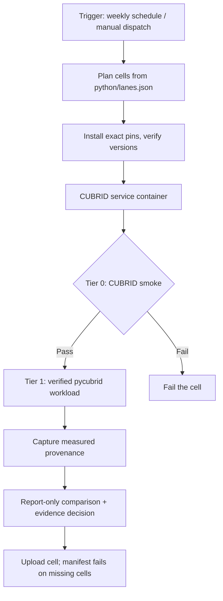
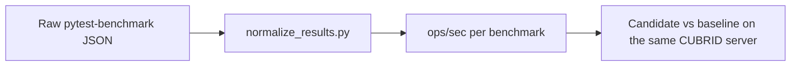
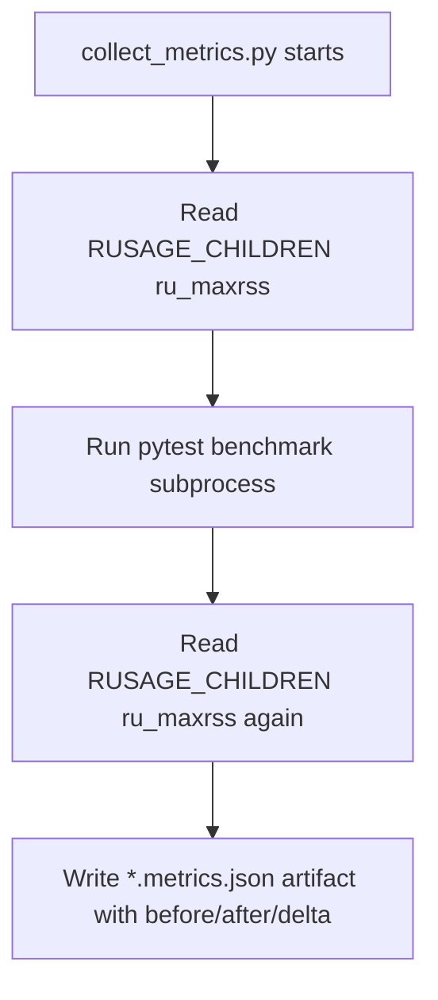
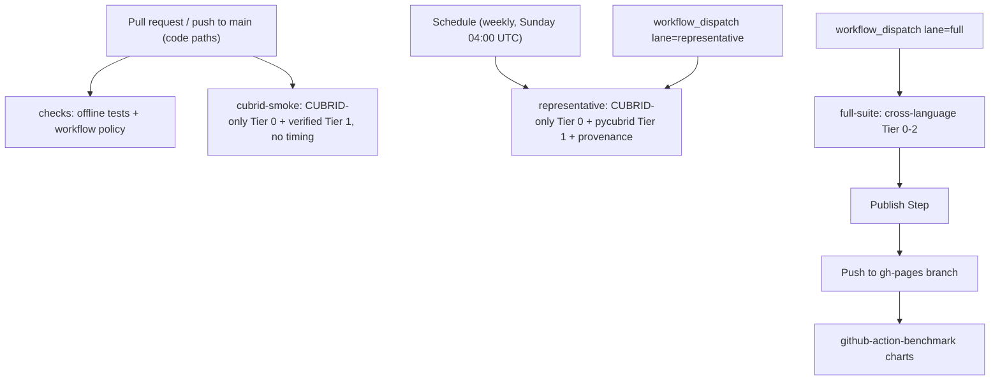

# Benchmark Methodology

How the CUBRID Benchmark suite measures the CUBRID Python stack. The maintained track compares
pycubrid and sqlalchemy-cubrid revisions (and the CUBRIDdb reference in experiments) **on the same
CUBRID server**. The cross-database CUBRID vs MySQL material below is marked as historical or as
Track B research.

## Overview (maintained pinned lane)



## Tier Structure

### Tier 0 — Smoke Tests

**Purpose**: Verify database connectivity and basic operation before running expensive benchmarks.

**What it tests**:
- Connectivity to CUBRID (port 33000); the Track B suites also check MySQL (port 3306)
- Basic `INSERT` / `SELECT` / `UPDATE` / `DELETE` operations
- Schema compatibility

**Languages**: Python, TypeScript, Go

**Runtime**: ~30 seconds

**When it runs**: CUBRID-only on every PR and push that touches benchmark code (`cubrid-smoke`), in
the weekly `representative` lane, and in every manual full-suite run.

### Tier 1 — Full Benchmarks

**Purpose**: Measure real performance characteristics under controlled conditions.

**What it tests**:
- Bulk `INSERT` throughput
- Primary key `SELECT` latency
- Range `SELECT` with filtering
- `UPDATE` throughput
- Mixed read/write workloads
- Extended connection and concurrency workloads

**Languages**: Python, TypeScript, Go

**Runtime**: ~10-15 minutes

**When it runs**: pycubrid Tier 1 in the weekly `representative` lane; the cross-language Tier 1
only through a manual `workflow_dispatch` with `lane=full` (never on PRs).

## Database Setup

The maintained Python lanes run one CUBRID service container per cell: `cubrid/cubrid:11.4` for
the representative lane, 10.2 and 11.4 for the release lane (`python/lanes.json`), with database
`benchdb` and user `dba` (no password). The image digest and server build are recorded in each
run's `comparison_identity`.

The Track B suites and the historical experiments use `docker/compose.yml` (`cubrid/cubrid:11.2`
on 33000, `mysql:8.0` on 3306 with `root` / `bench`).

### Schema

`scripts/apply_schema.py` (`make seed`) applies `schema/cubrid_init.sql` and `schema/seed.sql` to
CUBRID. `--with-mysql` also seeds MySQL for the Track B suites and the archived modules.

## Metrics

### Primary Metric: ops/sec

All results are normalized to **operations per second** for consistent comparison.



### Secondary Metrics: Tail Latency and Memory

- `p95_latency` and `p99_latency` are **observed** sample percentiles, in seconds, of the
  per-round samples pytest-benchmark records in `stats.data`. pytest-benchmark stores each
  round's duration divided by its `iterations`, so a sample is the mean time of one call of the
  benchmarked function within a round. Python Tier 1 uses `iterations == 1`, so there a sample
  is one whole call, for example the 10,000 statements of one operation. It is never the latency
  of a single SQL statement. They use linear interpolation between the two closest
  ranks (Hyndman-Fan type 7, the `numpy.percentile` default) and are reported only with at least
  20 samples (p95) or 100 samples (p99). Otherwise the key is omitted and
  `latency_percentiles_unavailable` gives the sample count and reason. Python Tier 1 runs 5 rounds,
  so its outputs report p95/p99 as unavailable.
- No value is derived from mean and standard deviation. Earlier outputs (before this rule) wrote
  `mean + 1.645 * stddev` / `mean + 2.326 * stddev` normal-model estimates under the same
  `p95_latency` / `p99_latency` names. Treat those historical values as estimates, never as
  observed tail latency.
- Child-process peak RSS is captured for Python benchmark commands
- Extended benchmark artifacts include both throughput and memory metadata

### Conversion Logic

From `pytest-benchmark` output (`scripts/benchmark_stats.py`, shared by `normalize_results.py` and
`emit_benchforge_v2.py`):
1. `stats.mean` must be finite and positive, and `stats.stddev` finite and non-negative
2. If `stats.ops` is present it must be finite and positive and is used directly; otherwise
   compute `1 / mean`
3. Include `stddev` as `+/- X%` range
4. Observed p95/p99 from `stats.data` as described above; every sample must be finite and
   non-negative
5. Any invalid value fails the conversion (`normalize_results.py` exits `2`) instead of
   producing a number

### Result Format

Normalized results follow the `github-action-benchmark` schema:
```json
{
    "name": "bench_insert_bulk",
    "unit": "ops/sec",
    "value": 95.4321,
    "range": "+/- 3.2%",
    "latency_samples": 5,
    "latency_sample_source": "pytest-benchmark stats.data (seconds per call: round duration / iterations)",
    "latency_quantile_method": "linear interpolation between closest ranks (Hyndman-Fan type 7)",
    "latency_percentiles_unavailable": "5 samples; p95 needs >= 20 samples, p99 needs >= 100 samples",
    "extra": "language=python tier=1 framework=pytest-benchmark"
}
```

With enough samples, `p95_latency` / `p99_latency` replace `latency_percentiles_unavailable`
(p95 alone appears between 20 and 99 samples). benchforge v2 results carry the same fields in
`extra`. The required benchforge v2 schema is unchanged, because these are optional `extra`
metrics.

## Extended Workloads

The Python extended workloads (`python/bench_pycubrid_extended.py`, revision
`tier1-extended-v2`) are `connect_query_close`, `execute_parameterized_loop`,
`executemany_literal_batch`, the opt-in `executemany_prepared_batch` and
`concurrent_select_4_threads`. Their exact contracts (what one call does, rows per call, the
timed region, commit inclusion, the verified result and the CAS protocol path proven by an
untimed packet probe) are in [Python Workload Contracts](WORKLOADS.md), together with the Tier 1
and SQLAlchemy Tier 2 contracts. The TypeScript and Go extended suites keep their own
historical names (`connect_disconnect`, `prepared_statement`, `batch_insert`,
`concurrent_select`), which do not follow these contracts.

## Memory Tracking

Python extended Tier 1 runs are executed via `scripts/collect_metrics.py`, which wraps pytest and captures RSS from `resource.getrusage(resource.RUSAGE_CHILDREN)`.



Metrics artifact fields:
- `rusage_children_before_kb`
- `rusage_children_after_kb`
- `peak_rss_delta_kb`

## Language-Specific Drivers

| Language | CUBRID Driver | MySQL Driver | Benchmark Framework |
|----------|--------------|--------------|---------------------|
| Python | pycubrid + sqlalchemy-cubrid | — (PyMySQL + SQLAlchemy: historical only, `make historical-python-mysql`) | pytest-benchmark |
| TypeScript | cubrid-client | mysql2 | Custom timer |
| Go | cubrid-go | go-sql-driver/mysql | `testing.B` |

## Historical Cross-Database Observations (2026-03, not targets)

From the archived cross-database experiments. These numbers mix DBMS and driver differences.
They are not current engineering targets and are not re-measured:

| Language | CUBRID vs MySQL | Notes |
|----------|----------------|-------|
| Python | ~4-6× slower (historical, 2026-03; no longer measured) | Both pycubrid and PyMySQL are pure-Python drivers; the gap combines DBMS (CUBRID vs MySQL) and driver differences and does not isolate either |
| TypeScript | ~0.4-0.5× (CUBRID faster) | cubrid-client uses efficient binary protocol |
| Go | ~1:1 (near parity) | Both drivers use native implementations |

## Normalization

The `scripts/normalize_results.py` script converts raw `pytest-benchmark` JSON output into the standardized format consumed by `github-action-benchmark`.

### Process

1. Read raw JSON from `pytest-benchmark` output
2. Extract `stats.ops` or compute from `stats.mean`
3. Calculate `stddev` as percentage of mean
4. Tag with language, tier, and framework metadata
5. Output standardized JSON

## CI Integration

### Workflow: `bench.yml`



**PR and push runs**: offline tests, workflow policy and a CUBRID-only correctness smoke. They
are never a throughput gate.

**Scheduled runs**: the bounded CUBRID-only `representative` lane, once a week. Its comparison is
report-only.

**Manual full suite**: Tier 0 → Tier 1 → Tier 2 → Normalize → Publish across languages. Only
Python Tier 0/1 are required. See `RUNBOOK.md`, "Scheduled and manual benchmark runs".

### Benchmark Tracking

Results are published to the `gh-pages` branch using [`github-action-benchmark`](https://github.com/benchmark-action/github-action-benchmark):
- Historical data stored in `dev/bench/` directory
- Alert threshold: 110% (warns if performance degrades by >10%)
- Charts auto-generated from historical data
- Published only from manual full-suite runs; alerts do not comment or open issues

## Running Locally

```bash
# Maintained track: CUBRID only
docker run -d --name cubrid-bench-114 -e CUBRID_DB=benchdb -p 33000:33000 cubrid/cubrid:11.4
python scripts/wait_for_cubrid.py --timeout 180
make seed
make tier0
make tier1-python
make tier1-python-extended
python3 scripts/normalize_results.py results/python_tier1.json
docker rm -f cubrid-bench-114

# Track B research (legacy CUBRID 11.2 + MySQL 8.0 stack)
make up
make tier0-ts tier1-ts tier1-ts-extended tier0-go tier1-go tier1-go-extended
make clean
```

## Extending Benchmarks

### Adding a new workload

1. Add the benchmark to the maintained Python module it belongs to
2. Add its contract to that module's `SCENARIOS` and to `docs/WORKLOADS.md` (one call, rows per
   call, timed region, untimed setup, verification, any claimed protocol path)
3. Verify results outside the timed region; a wrong or empty answer must fail
4. Start a new workload revision when what one call does changes

### Adding a new language (Track B research only)

1. Create a new directory under the repo root
2. Implement Tier 0 (connectivity) and Tier 1 (performance) benchmarks
3. Add Makefile targets: `tier0-{lang}`, `tier1-{lang}`
4. Update `bench.yml` workflow to include the new language
